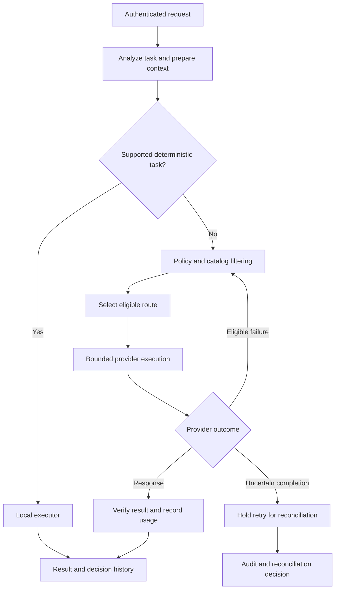

# SwitchAI

**An AI request-routing prototype that chooses an execution path using task requirements, budget, privacy constraints, and configured quality/reliability thresholds.**

I am developing SwitchAI to move model-selection and execution-policy decisions into a backend service. A simple request may need a deterministic function; a more demanding request may need a provider model, verification, and a carefully bounded fallback path.

| At a glance | |
| --- | --- |
| My role | Project owner and developer, covering routing policy, provider integration, execution lifecycle, persistence, and local web/API workflows |
| Stage | Local prototype with a deterministic/mock demo and a separate opt-in live-provider path |
| Engineering focus | Policy-constrained optimization, bounded execution, idempotency, uncertain completion, and auditable decisions |
| This repository | Public technical case study; the full implementation remains private |

[Problem and motivation](#problem-and-motivation) · [Architecture](#architecture) · [Core engineering](#core-engineering) · [Technology stack](#technology-stack) · [Verification and limitations](#verification-and-limitations)

**Inspect runnable code:** [source-derived route selector, synthetic candidate demo, and tests](examples/). No provider credentials or paid calls are required.

## Problem and motivation

Choosing an AI model involves more than picking a familiar name. Providers describe differences in capability, speed, and cost; see Anthropic's [model-selection guidance](https://platform.claude.com/docs/en/about-claude/models/choosing-a-model).

For an application, that choice also has operational consequences:

| Need | Risk without an execution policy | SwitchAI approach |
| --- | --- | --- |
| Keep simple tasks inexpensive | Send every request to a paid model | Recognize supported deterministic tasks before provider execution |
| Satisfy task requirements | Choose a cheap model that cannot perform the task | Filter by capability, context, privacy, and budget constraints |
| Recover from provider failures | Retry indiscriminately or silently change providers | Classify failures and bound allowed attempts and cost |
| Explain usage | Lose the reason for a route or the cost of its attempts | Record decisions, lifecycle events, verification, and usage outcomes |

The product hypothesis is that users and application developers benefit from a consistent execution policy across providers. The prototype explores that hypothesis; this showcase does not claim measured savings, paying customers, or an independently validated market size.

I chose this problem because routing is only the beginning: the system also has to explain what it executed, what it spent or may have spent, and whether retrying is safe.

## What the current prototype includes

- Rule-based task analysis, token estimation, context optimization, and output-token budgeting.
- Deterministic execution for supported operations, including a word-count demo.
- Candidate filtering using model/pricing catalogs and policy constraints.
- Cost-focused and weighted route-selection modes with minimum acceptance thresholds.
- A mock provider and implemented OpenAI Responses / Anthropic Messages adapters.
- Verification, bounded attempts, provider-failure handling, and execution events.
- Request idempotency, execution claims, decision snapshots, and reconciliation of uncertain outcomes.
- Local JSONL-backed stores for history, preferences, sessions, request lifecycle, verification, and audit records.
- A browser demo and HTTP API, with live-provider configuration and authentication handled separately.

### Example execution paths

**Deterministic:** a supported word-count request is handled locally and returns its result without a provider call.

**Provider-backed:** a summary request is analyzed, filtered against eligible routes, executed through a registered provider adapter, checked with the applicable verifier, and recorded with cost and lifecycle information.

The default local demo uses deterministic functions or the mock provider. Live calls require explicit configuration; the existence of an adapter is not presented as evidence that paid calls were exercised during this documentation update.

## Architecture

The branches show the decisions that control whether a provider call is made and how its outcome is handled.

Fallback is bounded by configured attempt and cost limits. The loop does not imply unrestricted retries or a guarantee of provider-side exactly-once execution.

## Core engineering

### 1. Apply constraints before optimizing cost

**Decision:** reject ineligible candidates before ranking the remaining routes.

The policy guard checks model status, required modalities, context capacity, tool/reasoning support, allowed providers, privacy/local-only constraints, pricing availability/freshness, and expected/worst-case budget limits.

**Why it matters:** a low estimated cost is irrelevant when the route violates a requirement. Rejections carry reason codes rather than disappearing from the decision process.

### 2. Make the optimization policy explicit

**Decision:** support cheapest-acceptable selection and weighted scoring, while preserving minimum quality/reliability thresholds.

The cost-focused selector ranks acceptable candidates by estimated cost with deterministic tie-breaks. The weighted selector combines configured quality, reliability, cost, and latency values.

**Trade-off:** quality/reliability scores and latency expectations are configuration or evaluation inputs. The router does not turn those estimates into a universal guarantee of answer quality. Their calibration is a separate evaluation problem.

### 3. Bound the whole execution, including fallbacks

**Decision:** track attempts and cumulative cost in the execution manager, classify provider failures, and select the applicable verifier.

A fallback can be useful after an eligible failure, but it also consumes budget and can change the executed route. The result distinguishes intended and executed routes, attempts, provider failures, verification, and known or uncertain cost state.

**Why it matters:** selecting an inexpensive first model is not enough if unchecked retries make the total request expensive.

### 4. Treat uncertain completion as its own state

**Decision:** use request idempotency and execution claims, and avoid automatic duplicate execution when provider completion is uncertain.

A connection failure can occur after a provider accepts a request. The execution manager can mark the claim as uncertain, block a duplicate attempt, and retain an estimated upper bound for the uncertain cost. A reconciliation service checks the user, request, execution audit, and provider-request information before accepting a completion or safe-retry decision.

**Trade-off:** some requests need explicit reconciliation rather than an immediate retry. This protects against blindly repeating potentially billable work without claiming that every provider supports exactly-once execution.

### 5. Keep routing decisions inspectable

**Decision:** retain versioned catalog/policy context, routing snapshots, execution events, verification records, and usage outcomes.

JSONL-backed persistence supports the local prototype without adding a database service. Provider adapters isolate provider-specific HTTP contracts from routing and orchestration.

**Boundary:** local file persistence is not presented as a multi-instance distributed database. Stronger concurrency, durability, and deployment guarantees require further work.

## Technology stack

| Layer | Technology | Responsibility |
| --- | --- | --- |
| Language and contracts | TypeScript | Typed task, route, policy, provider, and lifecycle contracts |
| Runtime and API | Node.js, native HTTP server | Local browser/API entry points and application composition |
| Request analysis | Rule-based analyzer, token/context utilities | Supported task recognition and execution-budget preparation |
| Provider integration | OpenAI Responses API, Anthropic Messages API, mock adapter | Separate provider contracts and failure handling |
| Persistence | Local JSONL stores | Request records, sessions, preferences, routing history, and execution audit |
| Verification | TypeScript checks, Node.js test runner, HTTP smoke tests | Policy, adapters, orchestration, persistence, and request-path checks |
| Automation | GitHub Actions | Configured typecheck and test verification |

## My contribution

- Defining the product's task-to-execution workflow and routing-policy boundaries.
- Implementing candidate filtering, cost estimation, route selection, and provider adapters.
- Developing bounded execution, verification, idempotency, and uncertain-outcome reconciliation.
- Building local persistence, session-related components, and web/API demo paths.
- Maintaining unit and HTTP integration checks for routing and failure scenarios.

## Verification and limitations

The private repository includes tests for policy/routing, context and output budgets, pricing freshness, provider adapters, failover, idempotency, persistence, sessions, and reconciliation. HTTP smoke tests exercise the deterministic/mock request path.

The private implementation's `npm run verify` command combines TypeScript checks and the Node.js test suite. Those application checks and paid provider calls were not rerun as part of publishing this documentation.

Current boundaries and next priorities:

- Broader task and routing-quality evaluation is needed before making general savings or quality claims.
- Pricing/model catalogs must remain maintained and verified; stale data can invalidate cost decisions.
- Privacy filters express routing policy; they are not proof of a provider's contractual compliance.
- Billing products, wider provider coverage, distributed persistence, and production scaling remain future work rather than completed capabilities.

## Reviewing the project

The central technical question is: **how can a routing service choose an acceptable execution path and recover without losing control of cost, identity, or completion state?**

This showcase explains that design without distributing the private implementation. A technical walkthrough and a scoped source-code review can be arranged on request.

[Sunmin Lee — GitHub profile](https://github.com/sunminlee-ucd) · [LinkedIn](https://www.linkedin.com/in/sunmin-dev/)

*Implementation and supporting documentation reviewed on 18 October 2026.*
